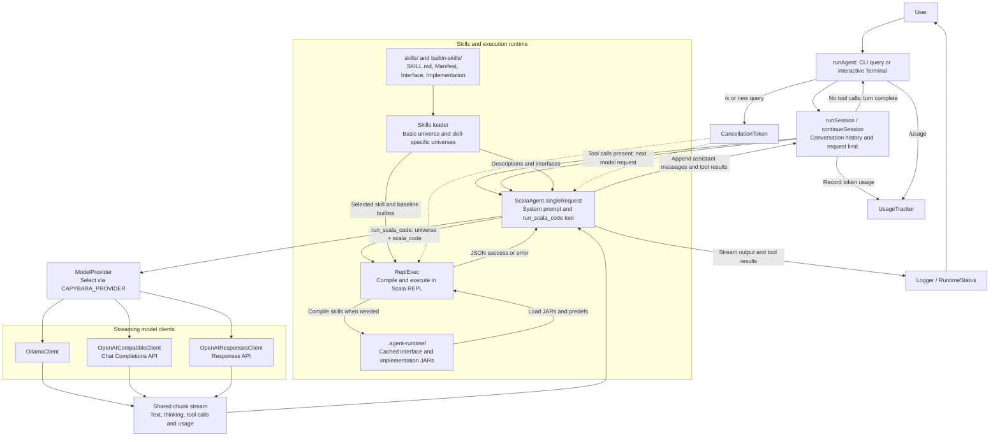

# Capybara Agent

agentic loop based on the ideas presented in https://github.com/lampepfl/tacit 

## Architecture



The session loop keeps conversation history across interactive turns and makes up
to 16 model requests per turn. `ScalaAgent` exposes a single tool,
`run_scala_code`, whose `universe` selects the basic Scala/Java environment or a
loaded skill. `ReplExec` loads baseline builtins plus any selected skill's JARs
and predefs, then resets the REPL state after each execution. Tool results return
to the model as conversation messages; streamed output goes to the logger.

## Model providers

Ollama is the default provider, using `qwen3.6:35b-a3b-coding-nvfp4`
at `http://localhost:11434`. Override the model with `CAPYBARA_MODEL`.

To use an OpenAI Chat Completions compatible API through
[sttp-ai](https://github.com/softwaremill/sttp-ai), configure the environment
before launching the agent:

```sh
export CAPYBARA_PROVIDER=openai
export CAPYBARA_BASE_URL=https://your-provider.example/v1
export CAPYBARA_MODEL=your-model-name
export CAPYBARA_API_KEY=your-api-key
./mill run
```

`CAPYBARA_BASE_URL` is the API base URL, including any version or proxy path;
the client appends `/chat/completions`. It defaults to `https://api.openai.com/v1`.
`CAPYBARA_MODEL` is required for either OpenAI-compatible provider. `OPENAI_API_KEY` is also supported,
with `CAPYBARA_API_KEY` taking precedence. Leave both keys unset for local servers
that need no authentication.

For a Responses API endpoint, use `CAPYBARA_PROVIDER=openai-responses` instead.
The client appends `/responses` to the same API base URL. For example, to try
[Muse Spark 1.3 Contributor Free on OpenCode](https://opencode.ai/v2/docs/console/models/),
create an API key in the [OpenCode Console](https://opencode.ai/console/) and run:

```sh
export CAPYBARA_PROVIDER=openai-responses
export CAPYBARA_BASE_URL=https://opencode.ai/inference/v1
export CAPYBARA_MODEL=muse-spark-1.3-contributor-free
export CAPYBARA_API_KEY=your-opencode-api-key
./mill run
```

Use the model ID directly, without an `opencode/` prefix. OpenCode currently lists
this model as a limited-time free contributor offering; its terms allow prompts
and completions to be used for model training. Check the linked model page for
current availability and terms.

The endpoint and model must support streaming and function tools in the selected
API format. Both OpenAI-compatible providers support streamed text, tool calls, conversation history,
cancellation, and token usage when the server returns it. The OpenAI-compatible
request uses standard API fields; Ollama's `think`, sampling options,
`CAPYBARA_CONTEXT_WINDOW`, and `CAPYBARA_KEEP_ALIVE` are not sent to it. The context
window setting still supplies the local `/usage` display; set it to your model's
actual capacity. `/think` controls reasoning for Ollama only.

The Responses provider sends the full conversation with `store=false`, including
completed reasoning items and encrypted reasoning when returned by the endpoint.
It uses `call_id` to pair function calls with their results. Failed, incomplete,
or truncated response streams do not execute pending tool calls.

Provider regression checks for both API formats are in `scripts/test-openai-compatible.scala`.
