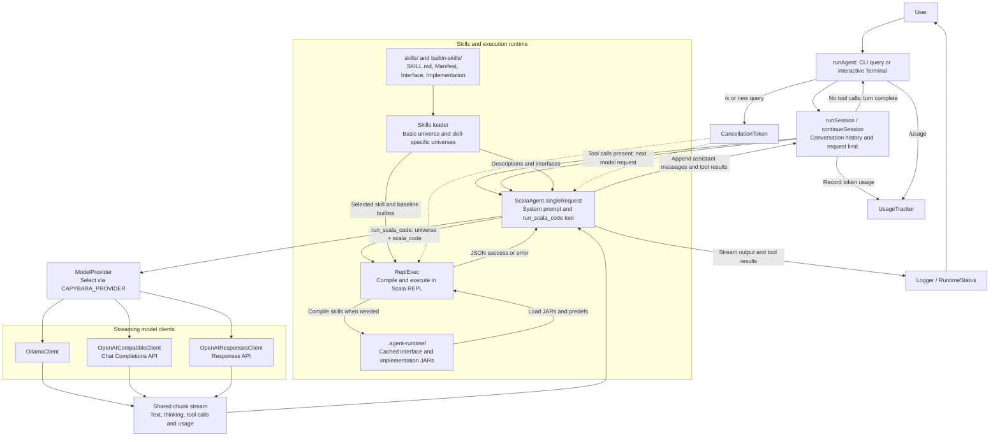
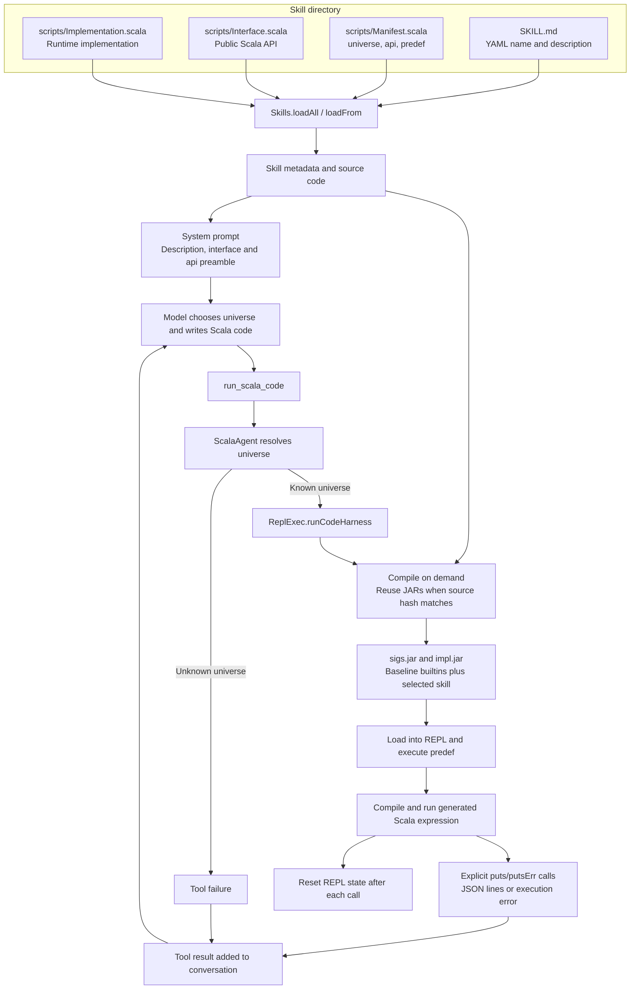

# Capybara Agent

agentic loop based on the ideas presented in https://github.com/lampepfl/tacit 

## Architecture



The session loop keeps conversation history across interactive turns and makes up
to 16 model requests per turn. `ScalaAgent` exposes a single tool,
`run_scala_code`, whose `universe` selects a single skill, or whose `universes` array selects
several atomic skills and their safe API dependencies. `ReplExec` loads baseline builtins plus any selected skill's JARs
and predefs in dependency order, then resets the REPL after each execution. Tool results return
to the model as conversation messages; streamed output goes to the logger.

## Terminal plugins and workflows

Start the interactive harness with `./mill run`. Use `/help` to discover commands;
Tab completes built-in and plugin commands. The bundled Scala workflow plugin adds:

| Command | Workflow |
| --- | --- |
| `/plan <goal>` | Inspect relevant code and propose steps and validation before implementation |
| `/review [scope]` | Review current changes, a file, or a named area for concrete bugs |
| `/handoff [focus]` | Summarize the conversation, verified results, and remaining work for another session |

For example:

```text
/plan add retry handling to the streaming client
Implement the plan, keeping the provider interfaces compatible.
/review the retry handling and cancellation paths
/handoff focus on validation that still needs a live provider
```

These commands submit ordinary prompts through the existing agent loop, history,
thinking mode, token accounting, and cancellation. Planning and review request
no writes in their prompts; they do not enforce a separate read-only capability
policy. `/clear` cancels the current turn and clears conversation history;
`/plugins` lists loaded plugins. Existing `/x`, `/usage`, `/sys-prompt`, and
`/think on|off|auto` commands remain available.

### Write a Scala plugin

Select a plugin source directory explicitly:

```sh
./mill run --plugin-dir examples/plugins
```

This loads the bundled workflows plus the example `focus` plugin:

```text
/focus Keep changes small and explain each validation result
/plan improve streaming error messages
/flow-stats
/focus off
```

Every immediate child directory defines one plugin. For example:

```text
my-plugins/
  greeting/
    plugin.properties
    GreetingPlugin.scala
```

`plugin.properties` names a public class with a no-argument constructor:

```properties
class=example.GreetingPlugin
```

```scala
package example

import capybara.agent.*

final class GreetingPlugin extends HarnessPlugin:
  val id = "greeting"
  val description = "A custom investigation workflow"
  override val commands = Seq(
    PluginCommand("investigate", "Investigate a problem before changing code", (args, context) =>
      if args.isBlank then PluginAction.Message("usage: /investigate <problem>")
      else PluginAction.Submit(
        s"Investigate this problem in ${context.workspace}. Gather evidence and propose a fix: $args"
      ))
  )
```

Run `./mill run --plugin-dir my-plugins`, then `/investigate <problem>`.
All `.scala` files under each child directory compile against the running host's
classpath and Scala version, using its bundled compiler and a Java subprocess.
Plugins can use host dependencies; dependency directives such as `//> using dep`
are not resolved. No separate publishing or service descriptor is required.
The entry point must be a class, rather than a Scala `object`.

The typed API in `src/HarnessPlugin.scala` provides:

- `commands`: named slash commands returning a local `Message` or an agent `Submit`.
- `transformPrompt`: transform every submitted prompt, including workflow prompts,
  in deterministic plugin order. A failed or empty transform prevents submission.
- `onEvent`: observe session start/close and turn start/completion/failure/cancellation.
- `close`: release resources when a plugin is replaced or the terminal exits.

Callbacks receive `PluginContext`, with the workspace path and an immutable
snapshot of committed conversation history. Successful completion events see the
updated history. Callbacks run serially for a session; keep them short so input
and cancellation remain responsive. Plugin errors are reported locally. A failed
observer does not stop the other observers, and a failed command does not call
the model. Failed turns do not commit partial conversation history.

The workflow plugin loads first, then source plugins in directory-name order.
Plugin IDs and command names must match `[a-z][a-z0-9-]*` and be unique. Plugins
cannot override built-in commands. The source loader checks the whole set before
installing it. Initial loading errors abort startup with diagnostics.

Edit sources, then use `/reload` without restarting the terminal. Reload is
allowed while idle; use `/x` first if a turn is running. A replacement set is
compiled and validated before the old set closes. Compilation or registration
failure keeps the old plugins active. Successful reload preserves conversation
history and thinking mode, and resets plugin instance state. Temporary compiled
classes and class loaders are released on replacement or exit.

**Trust:** plugins run as local host code with filesystem, process, and network
access. They can read conversation history and change submitted prompts. Load
source directories you trust. They are distinct from model skills: generated
Scala still uses the existing capability-checked skill runtime. Source plugins
are opt-in, available only in interactive mode, and are never loaded from an
implicit project or home directory.

## How skills work

A skill adds a Scala API to a named execution **universe**. At startup,
`Skills.loadAll` reads skill directories from `skills/`; `ScalaAgent` adds the
`basic` universe and loads `capybara-builtins` separately from `builtin-skills/`.
The model sees each available universe's description, interface, and API
preamble in the system prompt, then selects a universe when calling
`run_scala_code`.



Each skill uses four files:

| File | Role |
| --- | --- |
| `SKILL.md` | YAML frontmatter supplies the skill's `name` and `description`. The current prompt renderer uses those fields, rather than the Markdown body. |
| `scripts/Manifest.scala` | Declares `universe`, `api`, pure `predef` imports, and `bindings` connecting capability parameters to trusted factories. |
| `scripts/Interface.scala` | Defines the public types and methods shown to the model and compiled into `sigs.jar`. |
| `scripts/Implementation.scala` | Implements the API, compiled into `impl.jar`; its source is not included in the model prompt. |

For example, the `filesystem` manifest declares a `filesystem: fs.Filesystem`
parameter whose trusted value is `fs.internal.impl()`. A snippet can call
`puts(filesystem.list(filesystem.pwd()))`; it receives both filesystem and output
capabilities as explicit parameters.

Execution compiles the baseline builtins and selected skill as needed, caching
their JARs under `.agent-runtime/interface/<skill-name>/`. The cache hash covers
the Scala version, interface, implementation, API description, predef, and bindings. Keep the
skill's `name` and `universe` equal: compilation stores JARs by name, while the
REPL loads them by universe. The `basic` universe skips skill-specific JARs and
setup but still loads the baseline builtins for result formatting.

Each call starts from the initial REPL state, loads its APIs, evaluates the
generated snippet, and returns explicitly printed data or a failure to the model.
REPL definitions do not persist between calls; conversation history does.
External effects performed by a skill, such as writing a file, are not undone
by resetting the REPL.

## Developing a skill

A skill is still just `SKILL.md` and the three Scala files in `scripts/`.
It needs no Mill module, dependency duplication, or build definition. Prepare
its existing directory for Metals or IntelliJ with:

```sh
./mill run skill-ide --skill skills/filesystem
```

Open that directory in Metals, or import it as a BSP project in IntelliJ. The
command uses Scala CLI's `setup-ide`, with Scala 3.10.0, the original interface,
implementation and manifest sources, and the baseline builtins sources. Scala CLI
reads the sources' `//> using dep`, `file`, and compiler-option directives, so the
IDE classpath comes from the same declarations used for runtime packaging.
Rerun `skill-ide` and reload the IDE when you change dependency directives.

`skill-ide` also generates `.agent-runtime/SkillPreview.scala`: a readable example
of the actual capability parameters and factory calls the harness will generate.
It is disposable scaffolding; edit the original skill files. The IDE workspace
checks the sources together for development. `ReplExec` still checks the interface
independently in safe mode and compiles the snippet separately in safe mode before
executing it. The trusted implementation is not subjected to the snippet's safe
mode restrictions.

To create another skill, copy the four files from an existing skill, rename its
Scala package and manifest bindings, and run `skill-ide` on the new directory.

## How the manifest supplies capabilities

The interface describes a capability; it does not supply an instance. The
implementation defines the trusted factory. The manifest connects them with a
`bindings` vector containing the parameter name, parameter type, and factory
expression. For the baseline output capability:

```scala
val Manifest = (
  universe = "capybara-builtins",
  api = "Call puts(value) or putsErr(error) using the supplied output capability.",
  predef = "import system_impl.builtins; import builtins.given; import builtins.{puts, putsErr}",
  bindings = Vector((
    name = "output",
    tpe = "builtins.OutputStreams",
    value = "builtins.outputStreams(__harnessStdout, __harnessStderr)"
  ))
)
```

`predef` supplies shared imports and pure API names. Capabilities belong in
`bindings`, rather than global predef values. `ReplExec` combines the builtin and
selected skill bindings, generating a function like this for a filesystem snippet:

```scala
// Compiled in safe mode:
def snippet(using output: builtins.OutputStreams, filesystem: fs.Filesystem): Unit = {
  puts(filesystem.list(filesystem.pwd()))
  ()
}

// Compiled as trusted harness wiring, then called with the harness's streams:
def invoke(__harnessStdout: java.io.PrintStream, __harnessStderr: java.io.PrintStream): Boolean = {
  given __capybara_output: builtins.OutputStreams =
    builtins.outputStreams(__harnessStdout, __harnessStderr)
  given __capybara_filesystem: fs.Filesystem = fs.internal.impl()
  try { snippet(using __capybara_output, __capybara_filesystem); true }
  catch {
    case scala.util.control.NonFatal(error) =>
      __capybara_output.printErr(builtins.baseReflectiveShowable(error))
      false
  }
}
```

The harness invokes the compiled entry method with two host-owned `PrintStream`
instances. `OutputStreamsImpl` stores those streams and writes to them directly;
it does not use `Console`, `System.out`, or `System.err`. The REPL's global stream
redirection is disabled. Compiler diagnostics have their own capture buffer.
Uncaught exceptions are caught by the trusted caller and reported through the
supplied stderr handle. Factories are tagged `@caps.rejectSafe`, so the snippet
cannot manufacture another handle by calling the implementation directly.
`puts(value)` is a helper that requires an `OutputStreams` context parameter;
there is no global output capability. Capture checking sees that parameter when a
callback retains it.

For a skill-specific capability, the filesystem manifest declares:

```scala
bindings = Vector((name = "filesystem", tpe = "fs.Filesystem", value = "fs.internal.impl()"))
```

Keep skill `name` and `universe` equal. Parameter names must be valid Scala
identifiers and unique across the selected skill and builtins. The manifest's
factory code is trusted configuration; the model sees the public API and parameter
names/types, not the factory expressions.

## Running snippets without an LLM

Run from the repository root:

```sh
./mill run skill-run --skill basic --file examples/snippets/basic.scala
./mill run skill-run --skill skills/filesystem --file examples/snippets/filesystem.scala
./mill run skill-run --skill builtin-skills/capybara-builtins --file examples/snippets/streams.scala
```

`skill-run` loads the skill and calls `ReplExec` directly, without initializing an
agent or contacting a model. Builtins is loaded once in every universe, including
when selected directly by its directory. Write the snippet as a function body, using supplied
parameter names and imports. For example:

```scala
puts(List(1, 2, 3).sum)
```

This emits one JSON line on stdout:

```json
{"special.success": 6}
```

Final expression values are discarded. Without `puts` or `putsErr`, successful
execution has no data output. `puts` emits JSON lines on stdout; `putsErr` emits
JSON lines on stderr. Each stream preserves its own write order. The command
forwards each captured stream to the corresponding process stream without merging.
Writing stderr alone does not mark execution as failed. An uncaught exception
emits `special.error` on stderr and marks execution as failed; earlier values on
both streams are preserved. The command exits nonzero for compilation or execution
failures. Compilation/setup failures go to stderr.

The editable `examples/snippets/streams.scala` demonstrates both streams and
intentionally throws afterward to demonstrate preserving output on failure:

```sh
./mill run skill-run --skill basic --file examples/snippets/streams.scala > /tmp/capybara-stdout.jsonl 2> /tmp/capybara-stderr.jsonl
```

Agent calls use the same capability wiring and execution path. For a successful
snippet containing `puts("hello"); putsErr("warning")`, both channels
are decoded independently and returned as arrays, including when empty:

```json
{"success":true,"stdout":["hello"],"stderr":["warning"]}
```

Runtime failures add `executionError` while retaining both output arrays.
Silent success has empty stdout and stderr arrays and displays no result. The
system prompt explains the separate channels and supplied output capability.

## Generic coding tools and demo

The `coding` skill supplies workspace-relative `list`, `read`, `write`, `replace`
and `edit` operations for UTF-8 text files. Its interface and the safe harness
control effects; `edit(path)(String -> String)` rejects callbacks that retain
output or another capability. It has no project-specific filenames, external
runtime, test runner or process sandbox.

Run these steps in the same Bash or Zsh terminal.

**1. Prepare the workshop**

```sh
./mill run workshop-setup
```

**2. Load the workspace settings**

```sh
source .agent-runtime/demo-workspaces/coding.env
```

**3. Run the snippet**

```sh
./mill run skill-run --skill coding --file examples/snippets/coding.scala
```

`workshop-setup` copies both tracked starters into local workspaces, builds the
skills and prints the next commands. It keeps existing participant edits on
repeat runs. The generated `.env` files contain only the workspace path.
For a fresh session, use `--directory .agent-runtime/another-workshop` and source
the environment file printed by setup.

The ordinary snippet lists files, edits Scala source and creates a text file.
Run `examples/snippets/coding-capture-output.scala` separately to see a
capture-checking rejection. No model or credentials are required.

For your own project, set `CAPYBARA_CODING_ROOT` before starting the agent or
running a snippet:

```sh
export CAPYBARA_CODING_ROOT=/absolute/path/to/project
./mill run skill-ide --skill skills/coding
./mill run skill-run --skill skills/coding --file /path/to/snippet.scala
```

The default workspace is the current directory. See
[the coding skill guide](skills/coding/README.md) and
[the capture-checking workshop](presentations/capybara-architecture/workshop/README.md).
The generic editor returns ordinary printable file contents; it does not
classify them as secrets. Credential-bearing operations belong in separate
trusted capabilities, such as the GitHub skill below.

To inspect generated commands without executing a snippet:

```sh
./mill run skill-transcript --skill skills/coding --file /path/to/snippet.scala
```

## Composing atomic skills

A tool call can select several skills using `universes: ["coding", "github"]`.
The legacy `universe` field still works for single-skill calls. The harness
resolves dependencies, rejects cycles and binding conflicts, compiles safe APIs
in dependency order, loads each skill once, and injects separate contextual
capability parameters into one safe method.

Skills import each other's locally published interfaces with Scala CLI directives:

```scala
//> using repository ivy2local
//> using dep "dev.capybara.skills::coding-api:0.1.0-SNAPSHOT"
```

Publish explicitly with a name or directory (dependencies are published first):

```sh
./mill run skill-publish --skill coding
./mill run skill-publish --skill skills/github
```

The command prints ready-to-copy Scala CLI dependency directives. It refreshes
local Ivy without constructing capabilities, reading host credentials or running
a snippet. It publishes safe API artifacts, not an installable implementation
bundle. Runtime skills still come from installed skill directories.

Only checked interface artifacts are published under `dev.capybara.skills`.
Implementation factories remain separate, marked `rejectSafe`, and are called
by trusted harness wiring. An API dependency does not contain credentials or
implementation classes. Source directives determine the API compilation graph.
The separate manifest field `requires = Vector("coding")` determines which
runtime contexts are supplied automatically. GitHub's public `commit` method
declares `(using files: editing.TextFiles)`; the caller supplies file authority.
The GitHub factory does not capture that authority.

```sh
./mill run skill-run --skill coding,github --file /path/to/workflow.scala
./mill run skill-transcript --skill coding,github --file /path/to/workflow.scala
```

`SkillCompositionSuite` validates actual local publication, typed delegation,
dependency ordering and cross-skill capture-checking failures through MCP.

## GitHub issue-to-PR workflow

`github` supplies issue, branch, commit/push, draft PR and CI operations.
It delegates file reads to `coding` through its safe API. Editing remains in
`coding`; neither interface launches processes or a sandbox. Both implementations
are Scala-native, with no Python or Node dependency.

Configure `CAPYBARA_CODING_ROOT`, `CAPYBARA_GITHUB_REPOSITORY`, and the host-only
`CAPYBARA_GITHUB_TOKEN`, then follow [the GitHub guide](skills/github/README.md):

```sh
./mill run skill-run --skill coding,github --file examples/snippets/github-lab.scala
```

The example expects a local word-count starter clone and issue #1. It performs
real branch/PR writes with production wiring. The host token has no public
getter; outgoing content is checked before publication. `GitHubSkillSuite` tests
the full composed workflow with a local HTTP fixture and synthetic credentials.

## Model providers

Ollama is the default provider, using `qwen3.6:35b-a3b-coding-nvfp4`
at `http://localhost:11434`. Override the model with `CAPYBARA_MODEL`.

To use an OpenAI Chat Completions compatible API through
[sttp-ai](https://github.com/softwaremill/sttp-ai), configure the environment
before launching the agent:

```sh
export CAPYBARA_PROVIDER=openai
export CAPYBARA_BASE_URL=https://your-provider.example/v1
export CAPYBARA_MODEL=your-model-name
export CAPYBARA_API_KEY=your-api-key
./mill run
```

`CAPYBARA_BASE_URL` is the API base URL, including any version or proxy path;
the client appends `/chat/completions`. It defaults to `https://api.openai.com/v1`.
`CAPYBARA_MODEL` is required for either OpenAI-compatible provider. `OPENAI_API_KEY` is also supported,
with `CAPYBARA_API_KEY` taking precedence. Leave both keys unset for local servers
that need no authentication.

For a Responses API endpoint, use `CAPYBARA_PROVIDER=openai-responses` instead.
The client appends `/responses` to the same API base URL. For example, to try
[Muse Spark 1.3 Contributor Free on OpenCode](https://opencode.ai/v2/docs/console/models/),
create an API key in the [OpenCode Console](https://opencode.ai/console/) and run:

```sh
export CAPYBARA_PROVIDER=openai-responses
export CAPYBARA_BASE_URL=https://opencode.ai/inference/v1
export CAPYBARA_MODEL=muse-spark-1.3-contributor-free
export CAPYBARA_API_KEY=your-opencode-api-key
./mill run
```

Use the model ID directly, without an `opencode/` prefix. OpenCode currently lists
this model as a limited-time free contributor offering; its terms allow prompts
and completions to be used for model training. Check the linked model page for
current availability and terms.

The endpoint and model must support streaming and function tools in the selected
API format. Both OpenAI-compatible providers support streamed text, tool calls, conversation history,
cancellation, and token usage when the server returns it. The OpenAI-compatible
request uses standard API fields; Ollama's `think`, sampling options,
`CAPYBARA_CONTEXT_WINDOW`, and `CAPYBARA_KEEP_ALIVE` are not sent to it. The context
window setting still supplies the local `/usage` display; set it to your model's
actual capacity. `/think` controls reasoning for Ollama only.

The Responses provider sends the full conversation with `store=false`, including
completed reasoning items and encrypted reasoning when returned by the endpoint.
It uses `call_id` to pair function calls with their results. Failed, incomplete,
or truncated response streams do not execute pending tool calls.

Provider regression checks for both API formats are in `scripts/test-openai-compatible.scala`.
